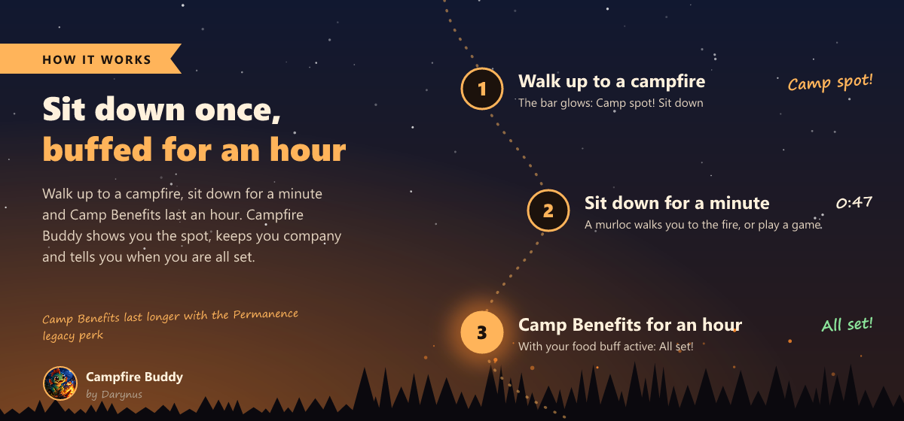
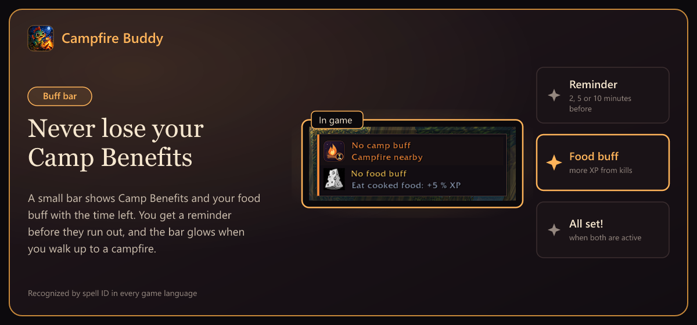
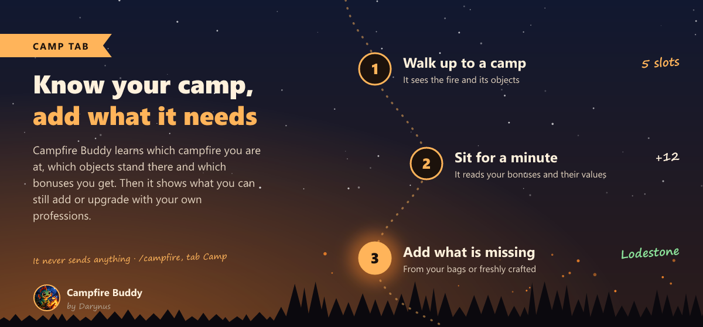
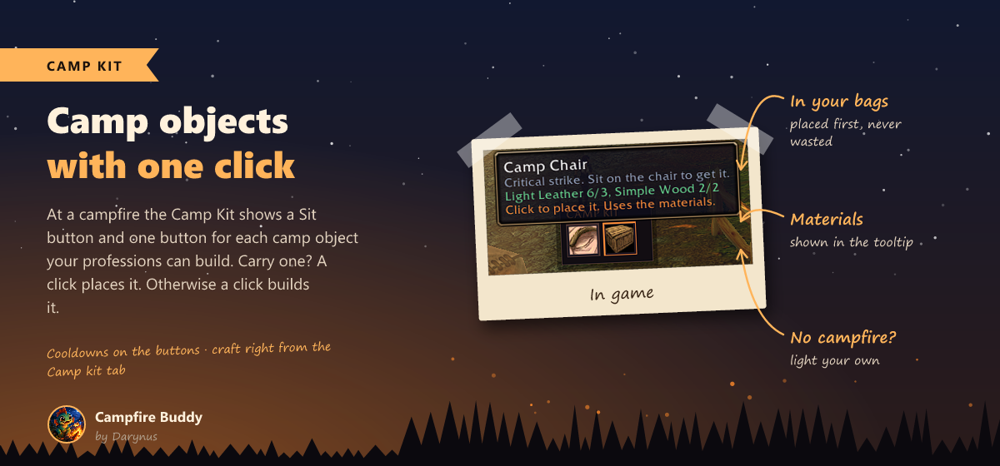
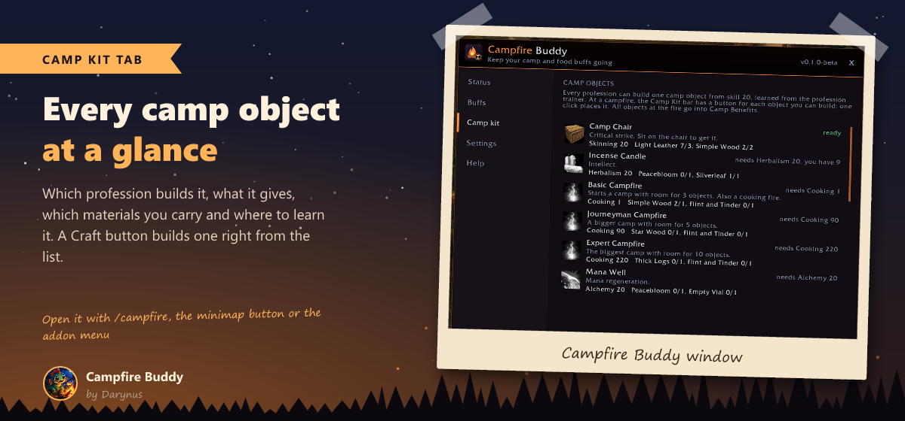
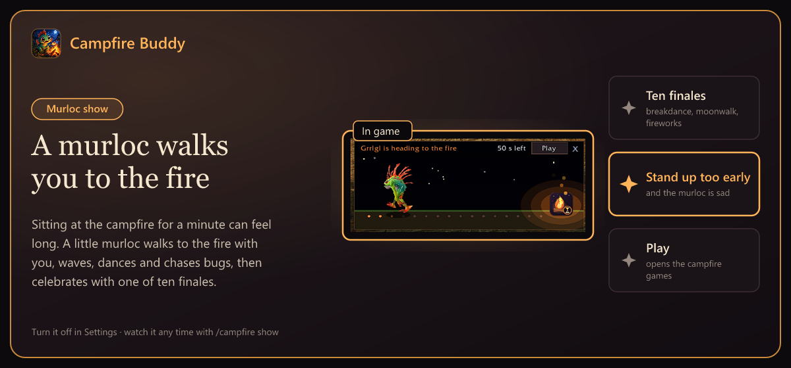
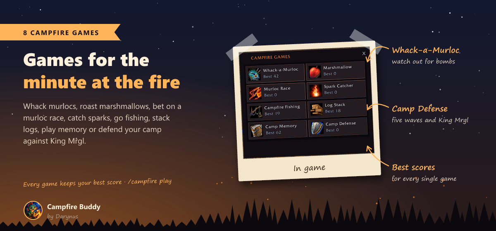
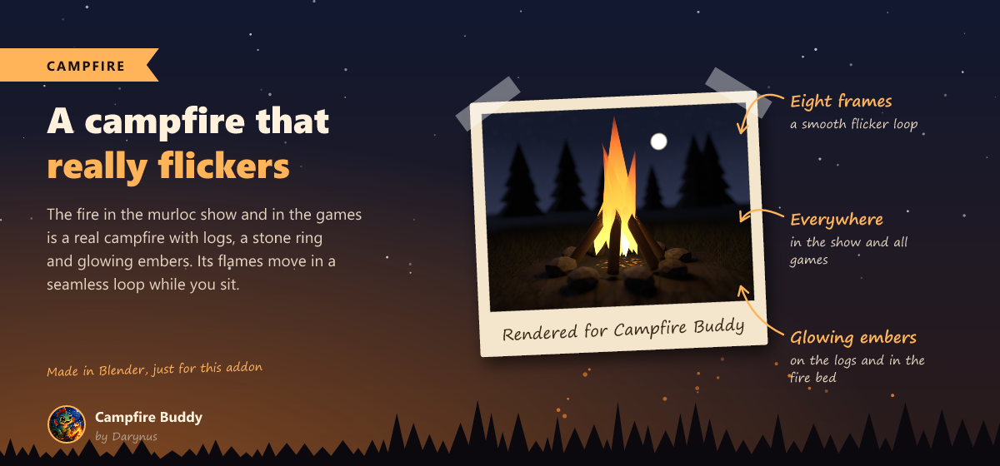
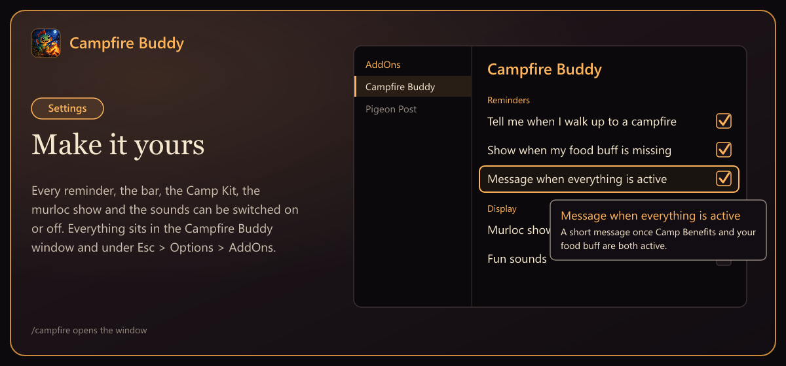

<h1 align="center">Campfire Buddy</h1>

<b>Never lose your Camp Benefits or your food buff again.</b> 
A small bar with the time left, reminders before they run out, a Camp Kit for your camp objects, and eight little campfire games to pass the time while you sit at the fire.

<a href="https://www.curseforge.com/wow/addons/campfire-buddy">CurseForge</a> ·
<a href="CHANGELOG.md">Changelog</a> ·
<a href="https://github.com/Darynus/CampfireBuddy/issues">Report a bug</a>

> **Beta for WoW Forever.** Made for the Forever beta client 1.60.1.

## Features

### Your buffs at a glance
- **Bar with your camp buffs**: Camp Benefits with time left and a progress bar, plus your food buff and any other buff you want to track.
- **Food buff**: see at once when your Well Fed buff from cooked food is missing.
- **Reminders**: 2, 5 or 10 minutes before a buff runs out, or off. One chat line at login or when you join a group without a camp or food buff.
- **Campfire nearby**: walk up to a campfire without Camp Benefits and the bar starts to glow: *Camp spot! Sit down.*
- **All set!**: a short message once Camp Benefits and your food buff are both active.

### Know your camp
- **Camp tab**: which campfire you are at (Basic 3, Journeyman 5 or Expert 10 slots), which objects stand there, which camp bonuses you get and how strong they are.
- **What you can add**: every object your professions can bring that this camp is missing, or a better one that replaces a smaller one.
- **Camp tip**: after a minute at the fire, one chat line tells you what this camp can still use from you.
- Learned from your Camp Benefits, the bonus buffs, objects placed by you or your group, and the fire you hover over. Nothing is sent to anyone.

### Camp Kit
- At a campfire, a small bar with a **Sit** button and your best **camp object** for every bonus, all three tiers. What the camp still needs comes first.
- Carry a finished object? One click places it. Otherwise one click builds one, just like *Create* in your profession window. Cooldowns are shown on the buttons.
- **Light a campfire**: away from a fire, when your Camp Benefits are missing, the Camp Kit offers your campfire (needs Cooking, Simple Wood and Flint and Tinder).
- **Class buffs**: an object that adds nothing on top of a class buff you already have says so in its tooltip.
- The **Camp kit** tab lists every camp object with its profession, its bonus, your materials and a **Craft** button, and shows which recipes you have not learned yet.

### Murloc show and campfire games
- **A real campfire** with logs, a stone ring and glowing embers, whose flames flicker in a seamless loop.
- While you sit for a minute, a **baby murloc** walks through a little night scene to the fire and ends with one of ten finales. Stand up too early and he is sad.
- Click **Play** for eight little games, each with its own best score: Whack-a-Murloc, Marshmallow, Murloc Race, Spark Catcher, Campfire Fishing, Log Stack, Camp Memory and Camp Defense with King Mrgl.
- **Fun sounds** in the show and the games, can be turned off.

### Settings
The window looks and feels like the game's own windows. Every reminder, the bar, the Camp Kit, the murloc show and the sounds can be switched on or off, in the Campfire Buddy window and under *Esc > Options > AddOns*.

## Install

- **CurseForge app**: search for *Campfire Buddy* under World of Warcraft, Forever.
- **By hand**: download the zip from CurseForge and put the `CampfireBuddy` folder into `World of Warcraft\_classic_beta_\Interface\AddOns`. Restart the game.

## Commands

| Command | What it does |
|---|---|
| `/campfire` | open or close the window |
| `/campfire bar` | show or hide the bar |
| `/campfire lock` | lock or unlock the bar |
| `/campfire show` | watch the murloc show |
| `/campfire play` | open the campfire games |
| `/campfire test` | show the reminder once |
| `/campfire help` | list all commands |

## Safety

Campfire Buddy reads your own buffs, bags and professions and what you see at the campfire, and shows them. It sends no messages and does nothing on its own. Sitting down, building and placing camp objects only happen when you click a button, one action per click. Everything is recognized by IDs, so it works in every game language. Nothing is read in combat.

## Support

Made by a gamer, for gamers. Campfire Buddy is free and always will be.

Ideas, high scores and bug reports are welcome in the [issues](https://github.com/Darynus/CampfireBuddy/issues) or in the CurseForge comments. See you at the campfire!
