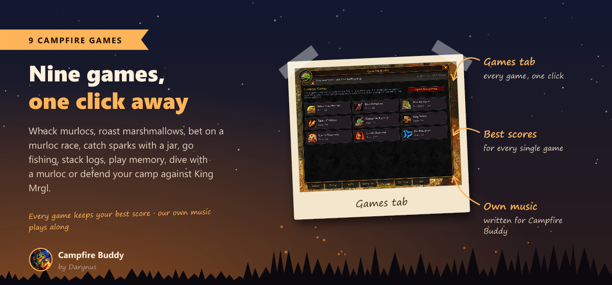
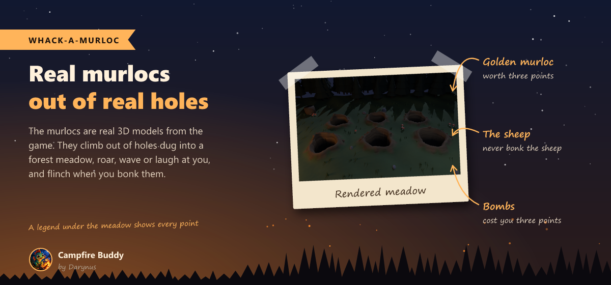
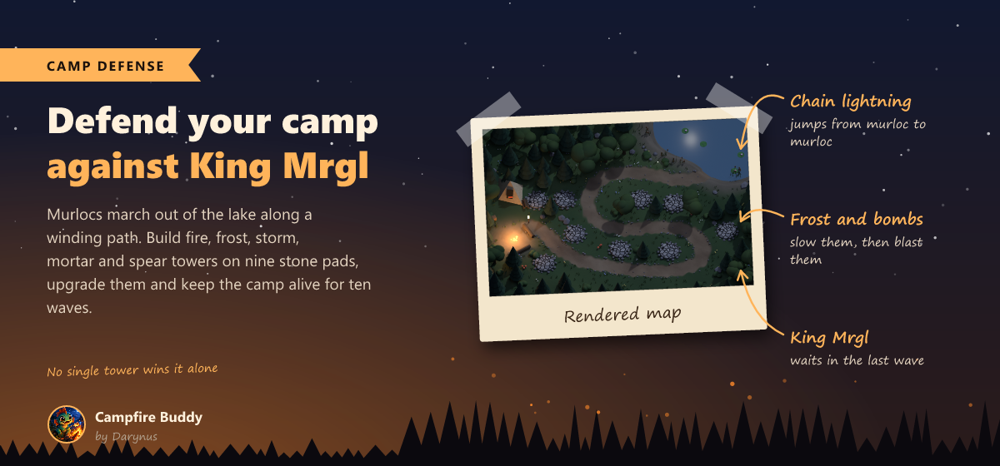
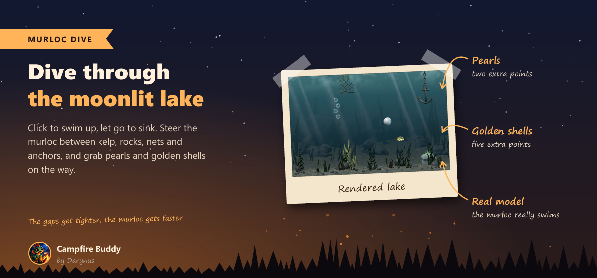
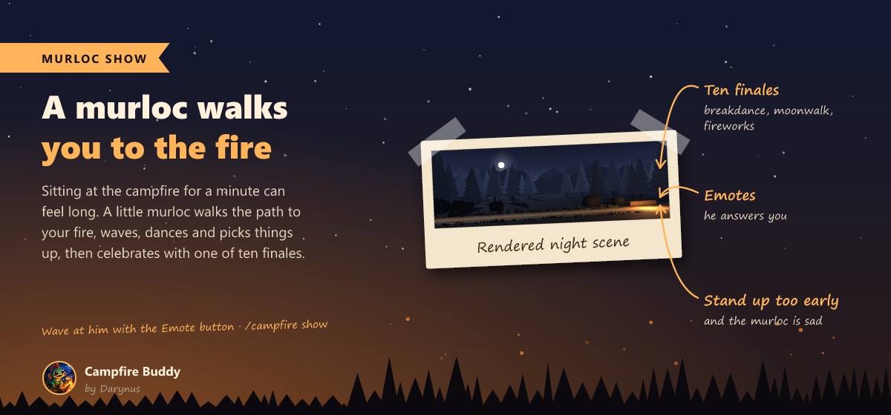
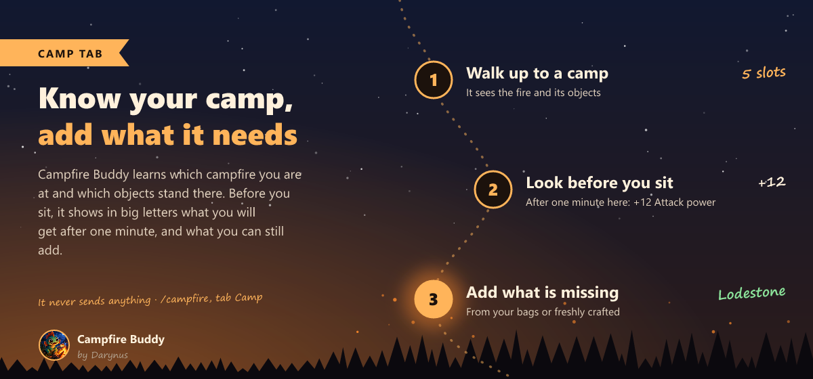
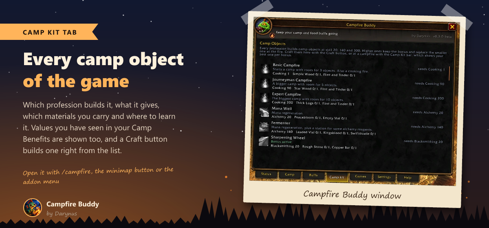
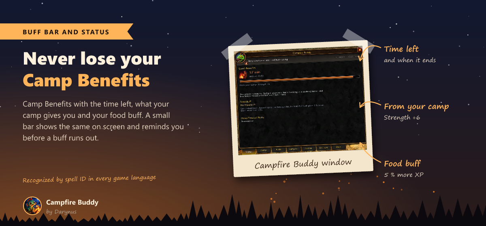
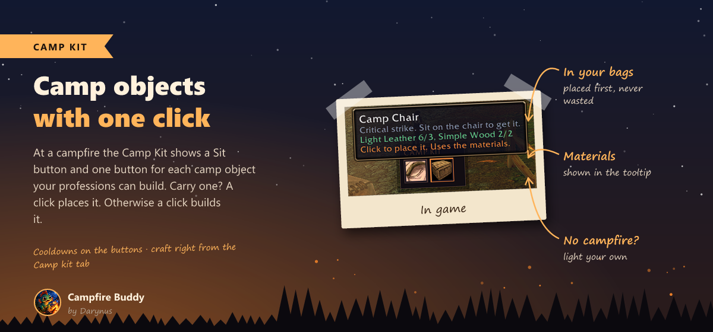
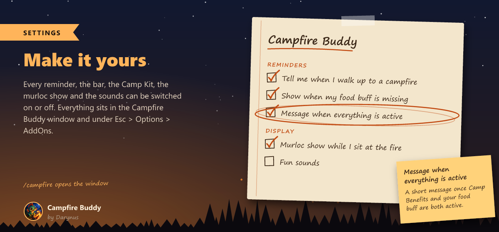

<h1 align="center">Campfire Buddy</h1>

<b>Never lose your Camp Benefits or your food buff again.</b> 
A small bar with the time left, reminders before they run out, a Camp Kit for your camp objects, and nine little campfire games to pass the time while you sit at the fire.

<a href="https://www.curseforge.com/wow/addons/campfire-buddy">CurseForge</a> ·
<a href="CHANGELOG.md">Changelog</a> ·
<a href="https://github.com/Darynus/CampfireBuddy/issues">Report a bug</a>

> **Made for WoW Forever** (client 1.60.1). The music, the minigames and all the art are made for Campfire Buddy by Darynus. Have fun at the campfire, and tell me in the comments what you think!

## Nine campfire games

Open them from the **Games** tab, with **Play** in the murloc show, with Shift-click on the minimap button or with `/campfire play`. Every game keeps your best score, and our own little tunes play along.

- **Whack-a-Murloc**: real murlocs climb out of holes dug into a forest meadow. Golden ones are worth 3, bombs cost 3, and never bonk the sheep.
- **Camp Defense**: murlocs march out of the lake along a winding path to your tent. Build fire, frost, storm (chain lightning), mortar and spear towers on nine stone pads, upgrade them, call waves early for bonus embers and survive ten waves up to King Mrgl. Fast runners, armored brutes and healing oracles make sure no single tower wins it alone.
- **Campfire Fishing**: hold to cast, wait for the real bite after the nibbles, then reel with feeling so the line does not snap. Nine fish from the Reed Minnow to the Golden Gleamfin, a fish book with your biggest catch, and the odd soggy boot.
- **Murloc Race**: three real murlocs race along a moonlit beach. Bet your coins at the odds, cheer your runner on three times per race, and hold your breath at the photo finish.
- **Marshmallow**: roast it on a forked branch right over the flames, turn it, blow it out when it catches fire and eat it golden on both sides.
- **Spark Catcher**: catch the rising sparks with a glass jar, build combos up to x4, empty a full jar for a bonus and dodge the ash.
- **Murloc Dive**: swim a murloc through a moonlit lake between kelp, rocks, nets and anchors, and grab pearls and golden shells.
- **Log Stack**: drop the swinging log as straight as you can, the sawn off piece tumbles away.
- **Camp Memory**: find the pairs, Easy or Hard, round after round.

## A murloc walks you to the fire

While you sit for a minute, a baby murloc walks a little path through a moonlit forest to your fire. On the way he strolls, waves, dances, picks things up and takes a rest, and at the fire he ends with one of ten finales, from breakdance to fireworks. Wave at him with the Emote button and he answers. Stand up too early and he is sad.

## Know your camp

- **See what you get before you sit**: in big letters, what Camp Benefits will give you after a minute at this fire, for example +12 Attack power and +14 Strength. Green helps you, grey you already have.
- **Is it worth sitting down?** Campfire Buddy knows your class and spec and tells you how many bonuses at this fire help you. Bonuses that do little for you are dimmed.
- **The camp itself**: which campfire you are at (Basic 3, Journeyman 5 or Expert 10 slots), which objects stand there, also the ones placed by strangers nearby, and what you can still add or upgrade.
- **Campfires on your world map**: fires you visited or lit, and your group's, with objects and time left.

## Your buffs at a glance

- **Buff bar**: Camp Benefits and your food buff with the time left. Add any other buff you want to keep an eye on.
- **Reminders** 2, 5 or 10 minutes before a buff runs out, plus one chat line at login or when you join a group without them.
- **Camp spot!** The bar glows when you walk up to a campfire without Camp Benefits.
- **All set!** A short message once Camp Benefits and your food buff are both active.
- The time is read from the buff itself, so the Permanence legacy perk just works.

## Camp Kit: camp objects with one click

- At a campfire you get a **Sit** button and your best camp object for every bonus, from Camp Chair and Lodestone up to Rock Garden, Master Forge and Fishing Hut. What the camp still needs comes first.
- Carry one? A click places it. Otherwise a click builds it, just like *Create* in your profession window. Cooldowns are shown on the buttons.
- **No campfire around?** When your Camp Benefits are missing, the Camp Kit offers to light your own.
- The **Camp kit** tab lists every camp object of the game with its profession, its bonus, the values you have seen, your materials and a **Craft** button.

## Make it yours

The window looks and feels like the game's own windows. Every reminder, the bar, the Camp Kit, the murloc show, the music and the sounds can be switched on or off: in the Campfire Buddy window (`/campfire`), from the minimap button and under *Esc > Options > AddOns*.

## Install

- **CurseForge app**: search for *Campfire Buddy* under World of Warcraft, Forever.
- **By hand**: download the zip from CurseForge and put the `CampfireBuddy` folder into `World of Warcraft\_classic_beta_\Interface\AddOns`. Restart the game.

## Commands

| Command | What it does |
|---|---|
| `/campfire` | open or close the window |
| `/campfire play` | open the campfire games |
| `/campfire show` | watch the murloc show |
| `/campfire bar` | show or hide the bar |
| `/campfire lock` | lock or unlock the bar |
| `/campfire minimap` | bring the minimap button back |
| `/campfire test` | show the reminder once |
| `/campfire help` | list all commands |

## Safe and fair

- **Nothing happens on its own.** Sitting down, building and placing camp objects only happen when you click, one action per click. Campfire Buddy sends no messages.
- **Every game language**: buffs, professions and items are recognized by their IDs, never by names.
- **Combat safe**: nothing is read in combat, the games close when a fight starts and the Camp Kit never changes during combat.
- Free, no ads, and the code is open on [GitHub](https://github.com/Darynus/CampfireBuddy).

## Support

Made by a gamer, for gamers. Campfire Buddy is free and always will be. Ideas, high scores and bug reports are welcome in the comments or on [GitHub](https://github.com/Darynus/CampfireBuddy/issues). See you at the campfire!
